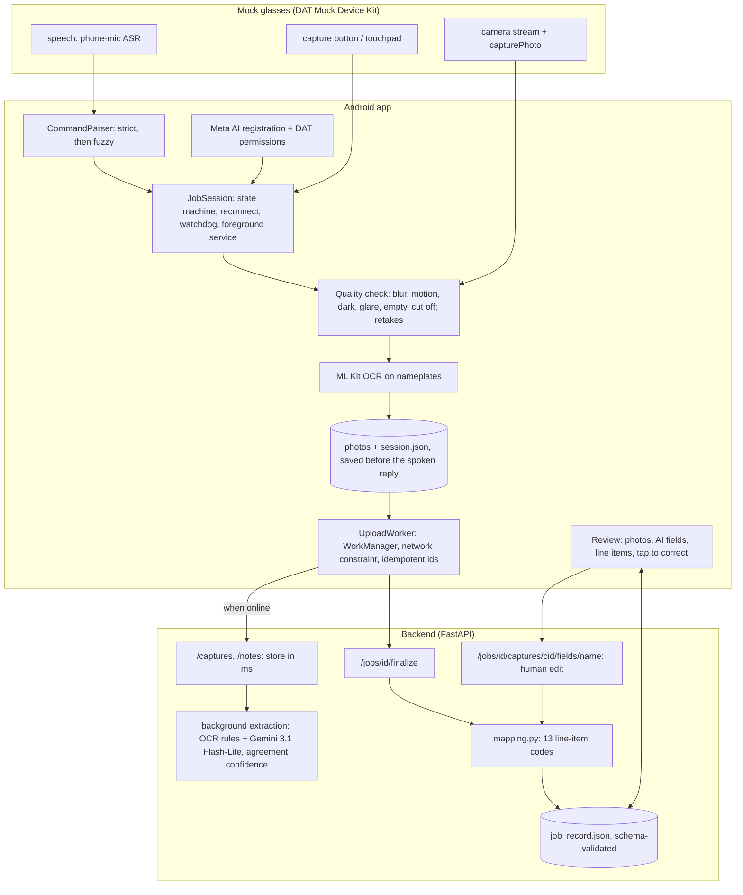

# FieldCapture

A hands-free field capture app for Meta AI glasses: Android, Meta Wearables Device Access Toolkit (DAT) 1.1.0, run on the Mock Device Kit. A water-damage technician walks a house and only speaks: "capture nameplate", "capture damage kitchen north wall", "note subfloor soft by the cabinet". The phone checks every photo on the device and asks for a retake when it is bad. It saves everything locally first and uploads when there is signal. The backend turns the walk into one schema-validated JSON job record with a confidence on every field and draft estimate line items. The office reviews the record on the phone and can correct any field, and the estimate rebuilds.

## Deliverables

| Brief deliverable | Where | Status |
|---|---|---|
| Code, committed as we went | this repo; `git log` | done |
| README: setup under 10 min, one architecture diagram, two-week plan | this file: [Setup](#setup-under-10-minutes-on-a-clean-mac), [Architecture](#architecture), [Two more weeks](#two-more-weeks) | done |
| Demo video (5 min max, own space, one caught and recovered failure) | _link added when recorded_ | **not recorded yet**; it will be shot on the tagged final build |
| Eval report: test set, accuracy per field, five worst failures | [`eval/REPORT.md`](eval/REPORT.md), failures in [`eval/failure_notes.csv`](eval/failure_notes.csv), findings in [`eval/FINDINGS.md`](eval/FINDINGS.md) | done on a **development set of web photos**; own-capture test set in progress (see [Evaluation](#evaluation)) |
| Research memo (one page) | [`RESEARCH_MEMO.md`](RESEARCH_MEMO.md) | done |
| Sample output: three JSON job records from real walk-throughs | [`samples/`](samples/) (`job_1`-`job_3`, one fully offline) | done, but shot with the phone on a desk; being replaced with home walks |
| Stretch goal | D, cost and latency: [`eval/STRETCH.md`](eval/STRETCH.md) | done (cost per job halved, capture-to-fields latency cut 5x) |
| Extra: the full system design, eight diagrams | [`docs/SYSTEM_DESIGN.md`](docs/SYSTEM_DESIGN.md) | done |
| Extra: SDK findings, model notes, live-session prep | [`docs/SDK_NOTES.md`](docs/SDK_NOTES.md), [`docs/MODEL_NOTES.md`](docs/MODEL_NOTES.md), [`docs/LIVE_PREP.md`](docs/LIVE_PREP.md) | done |

### Core requirements

| Requirement | How it is met | Evidence |
|---|---|---|
| **SDK integration**: registration, permissions, start / pause / resume / stop, recovery from a mid-walk disconnect | "Connect to Meta AI" card (`startRegistration`, `registrationState`, error stream, `handleIntent` for the `fieldcapture://` return, unregister); DAT camera and microphone permission requests; job state machine IDLE → CONNECTING → ACTIVE ⇄ PAUSED, RECONNECTING with backoff, STOPPED; a 5 s frame watchdog; foreground service; a job restored after the app is killed | `JobSession.kt`, `JobTest` (6 cases), `docs/SDK_NOTES.md` (drills with power off, doff, fold, force-stop) |
| **Three voice commands** (+ phone-mic fallback explained) | strict grammar first, then a noise-tolerant fuzzy pass; on the mock the glasses' speech service runs on the phone microphone (`LIVE_DEVICE_ASR`), which *is* the phone-mic fallback ([why](#voice-commands)) | `CommandParserTest` (77 phrases + every app reply) |
| **On-device quality check** (blurry, dark, badly framed) with a retake prompt | blur, motion blur, dark, glare, nothing in view, nameplate text cut off; spoken prompt, 2 retakes, then the photo is kept and marked `low` | [thresholds and how they were picked](#capture-quality-check-on-the-phone), `tools/tune_thresholds.py` |
| **Extraction** with a confidence on every field | nameplate: two readers (on-phone OCR and Gemini) with agreement scoring; damage: room and surface from voice, type and size from Gemini; notes structured by Gemini | [Extraction](#extraction-and-confidence) |
| **Job record + 10-15 line-item codes** | JSON Schema 2020-12, validated on every finalize; 13 codes; mapping rules | `backend/schema/`, `backend/line_items.json`, `backend/mapping.py` |
| **Own evaluation**: 40+ frames, 10+ nameplates, 10+ low-light, per-field accuracy, five worst failures | pipeline and report done on a 43-frame development set; real-walk measurements below | [Evaluation](#evaluation) |
| **Bad connectivity**: queue on the device, upload when signal returns, nothing lost | files-first queue, WorkManager with a network constraint, idempotent ids, partial / complete records | [Offline drills](#job-record-line-items-and-offline) |

## Setup (under 10 minutes on a clean Mac)

Prerequisites: JDK 17, Android SDK (platform 36, build-tools 36.0.0, platform-tools), Python 3.11+, an Android phone (Android 12+) with USB debugging. No Android Studio needed: the Gradle wrapper downloads Gradle. DAT 1.1.0 comes from Maven Central (no GitHub token). The Developer Mode placeholders in the manifest are `0`, so no Meta developer app is needed for the mock.

```sh
git clone <repo> && cd <repo>

# 1. backend
python3 -m venv .venv && .venv/bin/pip install -r backend/requirements.txt
cp backend/.env.example backend/.env          # put your Gemini key (AI Studio, free tier) in GEMINI_API_KEY
cd backend && FC_VLM=1 ../.venv/bin/python -m uvicorn app:app --host 127.0.0.1 --port 8000 &
cd ..

# 2. phone
export JAVA_HOME=<jdk17>  ANDROID_HOME=<android sdk>      # or edit and `source env.sh`
adb reverse tcp:8000 tcp:8000                  # phone reaches the backend as 127.0.0.1:8000 over USB
cd android && ./gradlew installDebug && adb shell am start -n com.fieldcapture/.MainActivity
```

On first launch, grant the Android permissions and tap **Connect to Meta AI** (the mock completes it at once). Then press **Start job** and speak. Without `FC_VLM=1` the backend makes no model calls and returns on-phone OCR fields only.

- **Backend on another machine or a tunnel:** set `fc.backend=https://…` in `android/local.properties`, which is git-ignored. The default is `http://127.0.0.1:8000`.
- **Mock device:** the debug build pairs a mock Ray-Ban Meta on launch, powered on, unfolded and worn. Its camera is the phone's back camera, and its speech is live phone-mic recognition.
- **Developer tools** (bottom of the main screen):
  - a glasses simulator: power, worn, hinge, heat, low battery, touchpad, capture button
  - injected speech
  - registration switches: disconnect from Meta AI, make the next registration fail
- **Scripting over adb:** `tools/fc.sh start "say:capture nameplate" powerOff powerOn stop`.

Tests, none of which call the model API:
- Backend: `cd backend && ../.venv/bin/python -m pytest`, 37 tests (mapping, schema, idempotent uploads, partial records, nameplate confidence, field edits).
- Android: `cd android && ./gradlew testDebugUnitTest`, covering the voice parser, the job state machine, and parity of the Kotlin and Python quality maths to 4 decimals. `connectedDebugAndroidTest` runs an end-to-end voice test on the phone.

## Architecture



Step-by-step diagrams (session states, capture pipeline, offline upload, extraction, finalize, review and edit, evaluation loop) are in [`docs/SYSTEM_DESIGN.md`](docs/SYSTEM_DESIGN.md).

## Voice commands

| say | result |
|---|---|
| start job / pause / resume / end job | session lifecycle; the job record outlives SDK sessions |
| capture nameplate | photo → quality check → OCR → "Nameplate." |
| capture damage [room] [surface] | e.g. "capture damage kitchen north wall". About 50 surfaces (walls, ceiling, flooring, framing, fixtures, appliances). The room carries over from earlier in the job when none is said |
| note [free text] | read back ("Noted: …") and flagged for review |
| retake | re-shoots the last capture |

**Why the phone mic:** the DAT speech service works in Developer Mode, so commands use the glasses' speech path. On the mock that path is the phone microphone (`LIVE_DEVICE_ASR`), so the brief's phone-mic fallback is what the mock runs today. On real glasses the same code would receive the glasses' microphone.

**Measured live, one speaker:**
- 15/20 commands right in a quiet room before parser fixes, 7/10 with a fan or TV on after fixes.
- On a home walk, all 17 captures and 3 notes were triggered by real speech.

**Noise tolerance:** a fuzzy pass corrects command, room and surface words within a small edit distance and drops fillers ("uh", "okay"). It accepts sound-alikes ("Captain nameplate", "Capital damage"). Note text is never altered. Free-text notes still garble in noise ("drywall soft behind the toilet" → "drywall behind soft wallet"), so every note is read back and marked for review.

**The app's own replies:**
- The app ignores anything that matches its last reply within 6 s (its own voice coming back through the mic).
- It accepts commands spoken over a reply. An earlier mute-while-speaking rule silently dropped a note said 3 s after a reply, so it was removed.
- A unit test checks that none of the app's 30 replies parses as a command. Details are in `docs/SDK_NOTES.md`.

## Capture quality check (on the phone)

Every photo is scored on the phone in `Quality.kt`. It uses the same maths as `tools/quality.py`, and a unit test checks they agree to 4 decimals. The checks:
- Laplacian variance (blur).
- Sharpness across versus down the image (motion blur, which leaves strong edges in one direction and fools the Laplacian).
- Mean luma (dark).
- Saturated pixels in the centre (glare).
- Edge density (nothing in view).
- For nameplates, an OCR text line touching the frame edge (cut off). This reuses the OCR uploaded as the on-device reader, so it costs no second pass (median 71 ms at 640 px).

**What the tech hears:**
- A blurry-only failure triggers up to 2 silent extra shots.
- Any other failure gives one prompt: "Too dark. Turn on your light.", "Blurry. Hold still.", "Glare. Tilt a little.", "Cut off. Step back." or "Nothing in view."
- After 2 retakes the photo is kept and marked `low`, so the app never blocks the walk. Line items from `low` photos go to review.

| check | threshold | how it was picked |
|---|---|---|
| dark (mean luma) | < 45 | catches 100% of darkened copies with 0% false rejects (tune split) |
| nameplate blur | < 70.7 | geometric middle of the gap between sharp and blurry; on our own phone photos the sharp label (120) passes and real blurry shots (46, 54) fail |
| damage blur | < 5.6 | damage texture is soft by nature; 0 false rejects |
| motion blur (both kinds) | across/down sharpness ratio < 0.24 | added after a sideways-shaken nameplate passed with blur 167. Over 266 photos the four motion-blurred ones score 0.13-0.25 and the first sharp one 0.29, so 0.24 catches 3 of 4 with no false retakes |
| nameplate glare | > 32% of centre saturated | 100% of glare copies caught, 0% false rejects |
| nothing in view | edge density < 0.01 | default, not tuned |
| nameplate cut off | an OCR line of 3+ characters within 3% of the frame edge | tune split: 12/12 cut-off copies caught, 1/12 plates rejected (web_np_06, labelled badly framed). Eval split: 11/13 caught, 1 false reject. Our own photos 001-011: 0 flagged. The first attempt, edge pixels in the border band, caught only 58% and rejected 3/13 good plates |

`tools/tune_thresholds.py` reproduces the table. The thresholds are still marked provisional: they were tuned on web photos, synthetic variants and our own phone photos, not on frames from real glasses.

## Extraction and confidence

- **Nameplate: two independent readers.**
  - ML Kit text recognition runs on the phone (median 71 ms, free, offline), and a rule parser pulls make, model, serial and date.
  - Gemini 3.1 Flash-Lite reads the same photo on the backend.
  - Field confidence = reader confidence × photo quality × format check, then **agreement**: both readers agree → 1-(1-a)(1-b); only one has a value → ×0.7; they disagree → ×0.4. Gemini's own confidence stays around 0.8 even when wrong; agreement is what brings wrong answers down.
  - About 100 brands are recognised, including common Indian ones. A guessed OCR brand counts only when it agrees, and "GE" matches "GE APPLIANCES".
  - On the evaluation set, correct makes average 0.62 confidence and no wrong value reaches green (≥ 0.8).
- **Damage:** room and surface come from the spoken command (confidence 0.9). Gemini gives the damage type (8 classes) and a rough size, using reference objects it can see (ceiling tile, outlet cover, door, studs 40.6 cm apart). Size confidence is capped at 0.5 without a reference and 0.8 with one.
- **Note:** Gemini turns the text into location, issue, material, severity and action.
- **Timing:** extraction runs in the background after the upload returns (the server answers in about 2 ms). Finalize waits for pending extractions and answers 503 so the phone retries.
- **Model choice:** a bake-off on 5 plates gave 3.1 Flash-Lite 11 correct / 2 wrong and 2.5 Flash 10/3; 3.5 Flash was too slow (11-36 s, timeouts). We ran on the free tier ($0 billed). Every call is logged with tokens and latency, and a local guard keeps the calls per day under the free-tier quota.

### Cost per job (paid-tier prices; Stretch D)

| walk | calls | cost per job |
|---|---|---|
| scripted 8-item walk, baseline | 7 | $0.00480 |
| same walk, `lean` profile | 8 | **$0.00239 (halved)** |
| home walk, 17 photos + 3 notes | 20 | $0.0134 |
| 13-photo walk | 13 | $0.0096 |

The `lean` profile halves the cost but loses 2 of 13 serial numbers, so nameplates stay on `baseline`. Details: [`eval/STRETCH.md`](eval/STRETCH.md).

## Reviewing and correcting a job in the app

After "end job" the main screen offers **Review job**, and **Recent jobs** lists the last five. Each photo card shows:
- the quality result
- every extracted field with its confidence: green ≥ 0.8, amber 0.5-0.8, red < 0.5 with "check", grey "not read"
- the draft line items that photo produced

Tap a photo to open it full screen with pinch-zoom, with its fields and line items underneath. Photos stay on the phone, so this works offline.

**Any field can be corrected by tapping it:**
- Damage type, appliance, room and surface pick from a list. Room and surface use the same vocabulary as the voice parser, and you can type any appliance not in the list.
- Size takes two numbers; make, model, serial and date take text.

The backend stores the correction as source `human` with confidence 1.0, keeps the AI's original under `previous`, and rebuilds the line items. A typed size counts as measured, and the edit survives a later finalize. Note fields are read-only for now, because note line items come from the spoken text.

## Job record, line items and offline

- **Schema:** `backend/schema/job_record.schema.json` (JSON Schema 2020-12, validated on every finalize).
- **Catalog:** `backend/line_items.json`, 13 codes, e.g. DRY-RR drywall remove and replace per sq ft, PNT-CLG, SUBF-RR, MOLD-TRT, DRY-EQ drying equipment per day, WH-RPL water heater replace.
- **Rules:** `backend/mapping.py`. Every line item carries its quantity basis (measured / estimated / default), source ids and a status (draft / needs_review / suggested).
  - Low confidence or a low-quality photo → `needs_review`.
  - A surface with no catalog item (sink, toilet, fan) → one "price by hand" review line, instead of drywall items.
  - Peeling paint → paint only.
- **Offline design:**
  - Every capture is written to disk (photo + `session.json`) before the spoken reply.
  - Each photo uploads on its own, as soon as it's taken and there's signal. A WorkManager job with a network constraint drains the queue when signal returns.
  - Ids are stable and the backend stores each id once, so a crash between upload and the "uploaded" mark can't create a duplicate.
  - A job finalized before everything arrives is `partial` with the missing ids listed, and becomes `complete` when they land.
- **Drill 1:** airplane mode, 3 captures + 2 notes, force-stop, reopen, 1 more capture, end job, network on. All 6 items uploaded **6 s** later, 0 lost, 0 duplicates; replaying every upload changed nothing.
- **Drill 2** (home, 2026-11-28): 5 photos shot fully offline. When the network returned, the first attempt hit a dropped connection; the retry 15 s later uploaded all 5 within 1 s. The record was complete 2 min 9 s after "end job", of which 1 min 19 s was the AI reading the photos one at a time.

## Evaluation

**Development set (`eval/REPORT.md`):** 43 frames (13 nameplates + 13 dark copies, 9 damage + 8 dark copies) and 12 notes. **The photos are openly licensed web images plus synthetic dark copies, not our own captures**, which the brief requires. `tools/eval.py` and `tools/report.py` re-run unchanged on our own labelled frames, and those numbers will replace these.

- **Nameplate fields with two readers:** make 85%, model 77%, serial 77%, date 100% (n=13 each); ML Kit alone 31-92%. Wrong answers carry lower confidence on every nameplate field (serial 0.28 wrong vs 0.69 right).
- **Damage type:** 56% (5/9), and its confidence does **not** drop when wrong (0.90 vs 0.95). It has a single reader, and most failures are photos with two kinds of damage.
- **Low light:** nameplate fields 85% → 71%, damage 56% → 38%; confidence roughly halves on dark frames. Frames the quality check rejects are less accurate (nameplate 73% vs 83%).
- **Five worst failures** and their causes are in `eval/REPORT.md` and `eval/failure_notes.csv`.

**Real walks in our own space** (2026-11-28, measured from the job records and logs; not a labelled test set):

| walk | what we measured |
|---|---|
| home walk, 17 photos + 3 notes | **brands 7/7 right** (Samsung, Pigeon, Faber, Whirlpool, Morphy Richards, Vantro, Livpure). Serial and date correctly empty, since these were front logos, not rating stickers. "No damage" right on a sink, a curtain rod and a fan. **The same scene got two different damage labels twice** (mold vs water stain), the known single-label weakness. Photo saved 0.3-0.5 s after the command. Capture to extracted fields: median 7.7 s, max 47 s (one 44 s Gemini call). The walk found a bug, fixed: a 1 × 1 cm size rounded to quantity 0 and failed the schema |
| 13-photo walk | every command understood first time, 0 low-quality photos, capture to fields median 12.9 s (calls queue behind the 13 s free-tier gap), record 1.1 s after "end job" |

## Assumptions

- One technician per job; `tech_id` is fixed (`tech-1`). Line items use imperial units (sq ft, lin ft); measured sizes are metric (cm).
- The room and surface the tech says are trusted over anything the image suggests.
- A water heater older than 10 years is suggested for replacement (status `suggested`, never `draft`).
- Day/month order on old plates is ambiguous, so dates are scored and used by year.
- One drying-equipment line per job, not per room.
- For the demo the phone reaches the backend over `adb reverse` (cleartext HTTP to 127.0.0.1) or a tunnel; production would use HTTPS with auth.

## Known limitations

- **The test set is not our own captures yet.** The rules require it; the pipeline is ready and the frames are being shot. Reported accuracy is from a development set.
- **Damage-type confidence is not calibrated**: it doesn't drop when wrong. Damage line items should be reviewed until a second signal exists (see [Two more weeks](#two-more-weeks)).
- **Size from one photo is a model estimate.** Stretch A was not done. A hole showing studs was still sized 35 cm, so it was priced as a patch. Use the field editor to correct it.
- **Cut-off is only checked for nameplates**, from OCR text touching the edge. A plate with no readable text, or a damage photo, is never flagged. On monitor test shots, other on-screen text at the frame edge gave false "cut off".
- **Faded serials vary between reads** (MJ84 vs MJB4). They are marked "check" because the two readers disagree.
- **Registration is tested on the mock only.** The mock completes it without the Meta AI consent screen or the `fieldcapture://` return trip; the "Meta AI not installed" and "not allowed" errors were never seen.
- **Not run on real glasses.** On the mock:
  - Voice stops reaching the app after a glasses reconnect, until the app restarts.
  - The phone recognizer beeps every ~5 s, so notification sounds are muted during a job.
  - Stills are 640 × 480.
  - Speech confidence is always 0.0, so we don't gate on it.
  - Identical repeated transcripts are swallowed by the SDK (a `StateFlow`), so mock injection sends a partial result first.
- **Sample records** were shot with the phone on a desk, so their photos show a monitor and a desk. Home-walk samples will replace them.
- **Gemini calls run one at a time, 13 s apart**, to stay inside the free tier. A burst of offline captures takes about 13 s per item to extract after sync, and one slow Google response (52 s for a note) delayed a record by about a minute.
- **The backend has no auth.** Field edits need the backend to be reachable.
- **Setup timing:** measured on the dev Mac with warm pip and Gradle caches (APK built in 32 s). A cold machine also downloads Gradle and the dependencies; not timed.

## What we cut and why

- **A room database:** the files-first queue (`session.json` + `uploaded.txt` markers) already gives atomic, lossless state with less code.
- **Cloud Vision as the second OCR reader:** no key, so Gemini took that role.
- **Automatic duplicate-photo detection:** an image fingerprint couldn't tell a repeat (distance 75) from a different wall (84), so a repeated shot is priced twice. "retake" replaces a photo instead.
- **Stretches A, B and C:** stretch D was done properly instead.
- **iOS:** one platform end to end beats two half done.

## Two more weeks

1. Shoot and label the 40+ own-frame test set, retune the thresholds on glasses frames, and drop `provisional`.
2. Damage: ask for every damage type present plus the main one, so confidence comes from the margin between them. Add a "framing visible" yes/no that prices exposed studs as replacement, and a reference-object size estimate checked against a tape measure.
3. Compare Gemini 2.5 Flash on nameplates only (faded serials), using the same cached test set.
4. Decode manufacture dates from serial numbers for the main water heater brands, so the over-10-years replacement rule can fire.
5. A paid-tier quota without the 13 s spacing, and parallel extraction for offline bursts.
6. A week-one field test with five techs: usable-frame rate, retakes per job, voice error rate, disconnects per hour, battery per hour, back-office edits per record.

## Live session readiness

Adding a fourth command such as "capture moisture reading [value] [location]" touches one sealed type and one grammar row in `CommandParser.kt`, one branch in `JobSession.handle()`, and, for a new record field, the schema and one mapping rule. The step-by-step plan and the failure drill are in [`docs/LIVE_PREP.md`](docs/LIVE_PREP.md).

## AI tools used

- **Claude Code** (Claude Opus, in VS Code) wrote most of the code, tests, scripts and docs under direction. It also ran the builds, adb drills and evaluations, and labelled the web development set by reading the images. Every number in this README was produced by a script in this repo or read from a job record, and checked by a human on the phone.
- **Meta's DAT skills and documentation search** for Claude Code: SDK usage, the Mock Device Kit and registration.
- **At runtime:** Gemini 3.1 Flash-Lite (Google AI Studio, free tier) for nameplate reading, damage classification and note structuring; ML Kit Text Recognition 16.0.1 on the device.

Spend: $0. All API use was on free tiers and no parts were bought.
