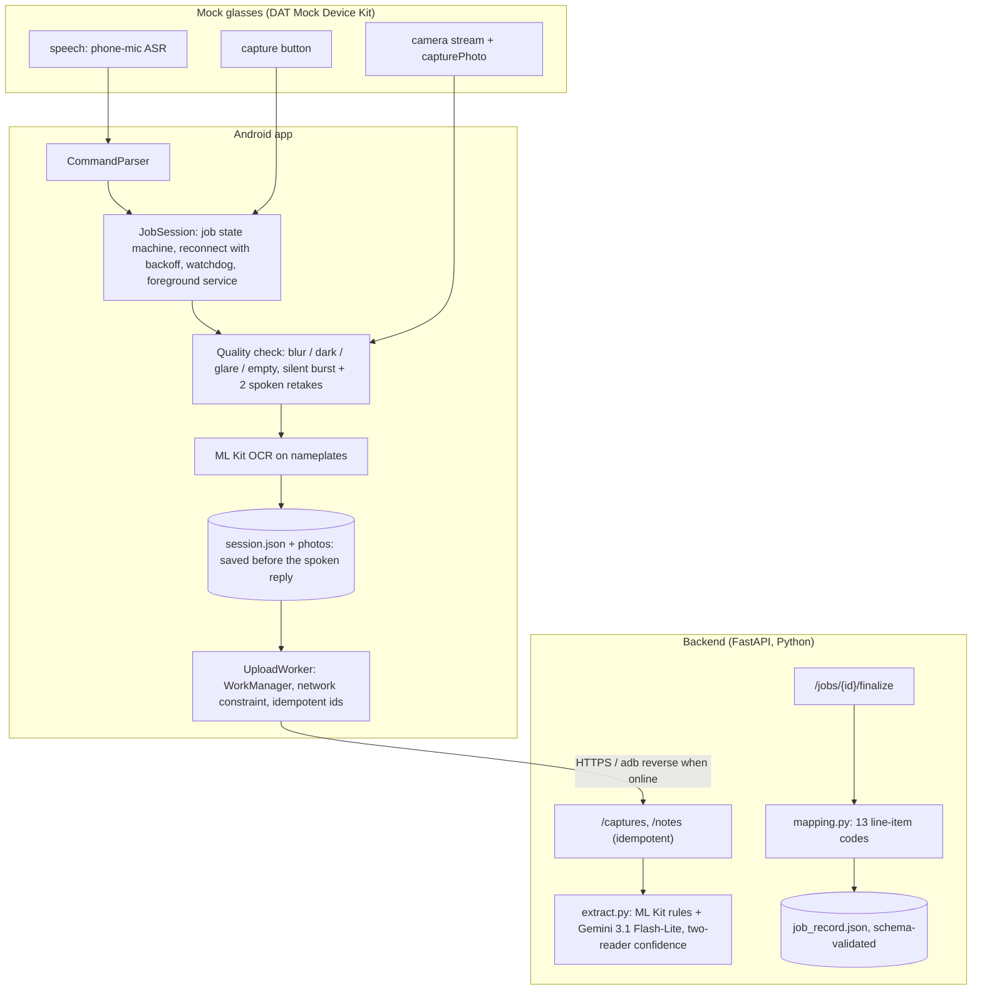

# FieldCapture

A hands-free field capture app for Meta AI glasses (Android, Meta Wearables Device Access Toolkit 1.1.0, run on the Mock Device Kit). A water-damage technician walks a house and only speaks: "capture nameplate", "capture damage kitchen north wall", "note subfloor soft by the cabinet". The phone checks every photo on the device and asks for a retake when it is bad, saves everything locally first, uploads when there is signal, and the backend turns the walk into one JSON job record with per-field confidence and draft estimate line items.

Demo video: _to be recorded from the tagged build (see Known limitations)._

## Setup (target: under 10 minutes on a clean Mac)

Prerequisites: JDK 17, Android SDK (platform 36, build-tools 36.0.0, platform-tools), Python 3.11+, an Android phone (Android 12+) with USB debugging. No Android Studio needed; the Gradle wrapper downloads Gradle. DAT 1.1.0 comes from Maven Central (no GitHub token), and the Developer Mode placeholders in the manifest are `0`, so no Meta developer app is needed for the mock.

```sh
git clone <repo> && cd <repo>

# 1. backend
python3 -m venv .venv && .venv/bin/pip install -r backend/requirements.txt
cp backend/.env.example backend/.env          # put your Gemini key (AI Studio, free tier) in GEMINI_API_KEY
cd backend && FC_VLM=1 ../.venv/bin/python -m uvicorn app:app --host 127.0.0.1 --port 8000 &
cd ..

# 2. phone
export JAVA_HOME=<jdk17>  ANDROID_HOME=<android sdk>      # or edit and `source env.sh`
adb reverse tcp:8000 tcp:8000                  # phone reaches the backend as 127.0.0.1:8000 over USB
cd android && ./gradlew installDebug && adb shell am start -n com.fieldcapture/.MainActivity
```

Grant the permissions, press **Start job**, then speak. Without `FC_VLM=1` the backend makes no model calls (ML Kit OCR fields only).

Mock device: the debug build pairs a mock Ray-Ban Meta on launch, powered on, unfolded and donned. Its camera is the phone's back camera; its speech source is live phone-mic ASR (`MockSpeechSource.LIVE_DEVICE_ASR`). The **Mock glasses** buttons simulate power off/on, doff/don, fold/unfold, heat, low battery and the capture button; **Inject speech** buttons send typed commands. The same actions are scriptable over adb: `tools/fc.sh start "say:capture nameplate" powerOff powerOn stop`.

Tests: `cd backend && ../.venv/bin/python -m pytest` (26 tests, no API calls) and `cd android && ./gradlew testDebugUnitTest` (parser, job state machine, Kotlin/Python quality parity). `connectedDebugAndroidTest` runs a voice end-to-end test on the phone.

## Architecture



## Voice commands

| say | result |
|---|---|
| start job / pause / resume / end job | session lifecycle; the job record outlives SDK sessions |
| capture nameplate | photo -> quality check -> OCR -> "Nameplate." |
| capture damage [room] [surface] | e.g. "capture damage kitchen north wall"; room carries over from the last capture if omitted. About 50 surfaces (walls, ceiling, flooring, framing, fixtures, appliances); surfaces with no catalog line item go to review |
| note [free text] | "Noted: ..." read back, flagged for review |
| retake | re-shoots the last capture |

The DAT speech service works in Developer Mode, so commands use the glasses' speech path (on the mock that is the phone microphone through `LIVE_DEVICE_ASR`; the brief's phone-mic fallback is therefore what the mock runs today). Measured live on one speaker: **15/20** commands right in a quiet room before parser fixes, **7/10** with a fan/TV on after fixes; free-text notes garble in noise ("drywall soft behind the toilet" -> "drywall behind soft wallet"), so notes are read back and always marked for review. TTS echo is filtered (our own reply was being heard as a command). Details: `docs/SDK_NOTES.md`.

## Capture quality check (on the phone)

Every photo is scored on the phone (`Quality.kt`, the same maths as `tools/quality.py`, checked equal to 4 decimals by a unit test): Laplacian variance (blur), the ratio of sharpness across vs down the image (motion blur, which leaves strong edges in one direction and fools the Laplacian), mean luma (dark), saturated pixels in the centre (glare), edge density (nothing in view), and for nameplates an ML Kit text line touching the frame edge (cut off). The OCR that runs for the check (median 71 ms at 640 px) is the same result uploaded as the on-device reader, so it costs no second pass. A blurry-only failure triggers up to 2 silent extra shots; otherwise the tech hears one prompt ("Too dark. Turn on your light.", "Blurry. Hold still.", "Glare. Tilt a little.", "Cut off. Step back.", "Nothing in view.") and gets 2 retakes before the photo is kept and marked `low` - the app never blocks the walk.

| check | threshold | how it was picked |
|---|---|---|
| dark (mean luma) | < 45 | catches 100% of darkened copies, 0% false rejects (tune split) |
| nameplate blur | < 70.7 | geometric middle of the class gap; checked on the tech's own phone photos: the sharp Razer label (120) passes, real blurry shots (46, 54) fail |
| damage blur | < 5.6 | damage texture is soft by nature; 0 false rejects |
| motion blur (both kinds) | across/down sharpness ratio < 0.24 | added after a sideways-shaken nameplate passed with blur 167; over 266 photos the four motion-blurred ones score 0.13-0.25 and the first sharp one 0.29, so 0.24 catches 3 of 4 with no false retakes |
| nameplate glare | > 32% of centre saturated | 100% of glare copies caught, 0% false rejects |
| nothing in view | edge density < 0.01 | default, not tuned |
| nameplate cut off | an OCR line of 3+ characters within 3% of the frame edge | tune split: 12/12 cut-off copies caught, 1/12 plates rejected (web_np_06, which is labelled badly framed); eval split: 11/13 caught, 1 false reject (web_np_09); our own phone photos 001-011: 0 flagged (012-018, a product page shot off a monitor with words running off the frame, are flagged). Every margin from 0.5% to 5% tied on tune, 3% is the middle. The first attempt, edge pixels in the border band, could not tell a cut-off plate from a well-filled close-up (58% caught, 3/13 good plates rejected) |

`tools/tune_thresholds.py` reproduces the table. Thresholds are still marked provisional: they were tuned on web photos + synthetic variants + 8 of our own phone photos, not on frames from real glasses.

## Extraction and confidence

- **Nameplate:** two independent readers. ML Kit text recognition runs on the phone (median 71 ms, free, offline) and a rule parser pulls make/model/serial/date; Gemini 3.1 Flash-Lite reads the same photo on the backend. Field confidence = reader confidence x photo quality x format check, then **agreement**: both readers agree -> 1-(1-a)(1-b); only one has a value -> x0.7; they disagree -> x0.4. Gemini's own confidence alone stays ~0.8 even when wrong; agreement is what brings wrong answers down.
- **Damage:** room and surface come from the spoken command (0.9); Gemini gives damage type (8 classes) and a rough size, with size confidence capped at 0.5 without a reference object and 0.8 with one.
- **Note:** Gemini turns the text into location / issue / material / severity, discounted for ASR errors.
- Extraction runs after the upload returns (the phone's request takes ~2 ms on the server); finalize waits for pending extractions and answers 503 so the phone retries if one is still running. Measured on real walks: voice command -> capture has its extracted fields, 2.9 s median / 3.3 s p90; cost per job $0.0048 baseline, $0.0024 with the `lean` profile (`eval/REPORT.md`, Stretch D).
- Model choice: bake-off on 5 plates - 3.1 Flash-Lite 11 correct / 2 wrong, 2.5 Flash 10/3, 3.5 Flash too slow (11-36 s, timeouts). Cost per job ~ **$0.006** at paid-tier prices (2 nameplates, 5 damage, 3 notes); we ran on the free tier ($0 billed; free-tier requests may be used by Google to improve its models). Every call is logged with tokens and latency; a local guard caps calls per day under the free-tier quota.

## Reviewing a job in the app

After "end job" the main screen offers **Review job**, and **Past jobs** lists the last five. The review screen shows every photo (tap it to open full screen with pinch-zoom, the quality result, the AI fields and its line items underneath; photos stay on the phone so this works offline) with its quality result, each extracted field with its confidence (green >= 0.8, amber 0.5-0.8, red < 0.5 with "check"; grey "not read" when the field is absent), the notes with their structured fields, and under each photo or note the draft line items it produced (highlighted when they need review, with quantity basis; items shared across photos name the others). The full estimate list lives in the job record (`line_items`) for the office. It reads the finalized record from the backend (`GET /jobs/{id}`); when the job has not uploaded yet or the backend is unreachable it shows what is on the phone (photos, quality, spoken room/surface) and says the AI results arrive after upload.

## Job record, line items, offline

- Schema: `backend/schema/job_record.schema.json` (JSON Schema 2020-12, validated on every finalize). Catalog: `backend/line_items.json` (13 codes, e.g. DRY-RR drywall remove and replace per sq ft, PNT-CLG, SUBF-RR, DRY-EQ drying equipment per day, WH-RPL water heater replace). Rules in `backend/mapping.py`; every line item carries its quantity basis (measured / estimated / default), source capture ids and a status (draft / needs_review / suggested). Low confidence or low photo quality -> needs_review.
- Offline: every capture is written to disk (photo + `session.json`) before the spoken reply. A WorkManager job with a network constraint uploads when signal returns; captures carry stable ids and the backend stores each id once, so a crash between upload and "uploaded" mark cannot duplicate. A job finalized before all captures arrive is `partial` with the missing ids listed, and becomes `complete` when they land. Drill on the phone: airplane mode, 3 captures + 2 notes, force-stop, reopen, 1 more capture, end job, network on -> all 6 items uploaded **6 s** later, 0 lost, 0 duplicates; replaying every upload changed nothing.
- Sample records: `samples/job_1.json` - `job_3.json`, three real walk-throughs (one fully offline then synced), all schema-valid; see `samples/README.md`. `jobs/83790B46.json` is the offline drill.

## Results (development set)

Full report: `eval/REPORT.md`. **These numbers come from openly licensed web photos plus synthetic dark copies, used as a development set.** The brief requires the test set to be our own captures; the same scripts (`tools/eval.py`, `tools/report.py`) re-run on our own labelled frames, and those numbers will replace these.

- Nameplate fields with two readers: make 85%, model 77%, serial 77%, date 100% (n=13 plates each); ML Kit alone 31-92%. Wrong answers carry lower confidence on every nameplate field (serial 0.28 wrong vs 0.69 right).
- Damage type 56% (5/9) and its confidence does **not** drop when wrong (0.90 vs 0.95) - single reader; most failures are photos with two kinds of damage.
- Low light: nameplate fields 85% -> 71%, damage 56% -> 38%; confidence roughly halves on dark frames. Frames the quality check rejects are less accurate (nameplate 73% vs 83%).

## Assumptions

- One technician per job; `tech_id` is fixed (`tech-1`). Units are imperial for line items (sq ft, lf), metric for measured sizes (cm).
- Room/surface spoken by the tech are trusted over anything the image suggests.
- A water heater older than 10 years is suggested for replacement (status `suggested`, never `draft`).
- Day/month order on old plates is ambiguous; dates are scored and used by year.
- The phone reaches the backend over `adb reverse` for the demo (cleartext HTTP to 127.0.0.1); production would use HTTPS.

## Known limitations

- **Test set is not our own captures yet.** The rules require it; the eval pipeline is ready, the frames are not shot. Reported numbers are a development set.
- **Cut-off is only checked for nameplates**, from OCR text touching the edge. A plate with no readable text, or a damage photo, is never flagged as cut off. Cut-off copies in the test data are synthetic crops.
- **Damage-type confidence is not calibrated** (see Results). Damage line items should be reviewed until a second signal exists.
- Not run on real glasses. On the mock: voice commands stop reaching the app after a glasses reconnect (injected speech 11/13 tries, live mic too) until the app restarts; the mock's phone recognizer beeps every ~5 s, so notification sounds are muted while a job is open; the mock gives 640x480 stills; ASR final confidence is always 0.0, so we do not gate on it.
- Size from a single photo is a model estimate (stretch A not done). Notes in noise garble.
- Fresh clone following this README on the dev Mac: backend installed, 26 tests passing and the APK built in 32 s, but with warm pip and Gradle caches; a cold machine also downloads Gradle and the dependencies (not timed).
- Demo video still to be recorded from the tagged build. The sample walks were run with the phone on a desk, so their photos show a monitor and a desk, not appliances or damage.
- Backend has no auth. Gemini calls are serialized and spaced 13 s apart to stay inside the free tier, so a burst of offline captures takes ~13 s per item to extract after sync.

## What we cut and why

- Room database: the files-first queue (`session.json` + `uploaded.txt` markers) already gives atomic, lossless state with less code.
- Cloud Vision as the second OCR reader: no key; Gemini took that role.
- Stretch A (size) and B/C: stretch D done properly instead.
- iOS: one platform end to end beats two half-done.

## Two more weeks

1. Shoot and label the 40+ own-frame test set from real jobs, then retune thresholds on glasses frames and drop `provisional`.
2. Damage: multi-label output with top-2 probabilities (margin as confidence), and a reference-object size estimate.
3. Cut-off check for damage photos (stain mask touching the edge); crop the plate to its OCR box before the model call (fewer tokens, better OCR).
4. Paid-tier quota without the 13 s spacing; parallel extraction for offline bursts.
5. Week-one field test with five techs (usable-frame rate, retakes per job, voice error rate, disconnects per hour, battery per hour, back-office edits per record).

## AI tools used

- **Claude Code** (Claude Opus, in VS Code) wrote most of the code, tests, scripts and docs under direction, ran the builds, adb drills and evaluations, and labelled the web development set by reading the images. Every number in this README was produced by a script in this repo and checked by a human on the phone.
- **Gemini 3.1 Flash-Lite** (Google AI Studio, free tier) at runtime for nameplate reading, damage classification and note structuring. **ML Kit Text Recognition 16.0.1** on device.

Spend: $0 (all API use on free tiers, no parts bought).
