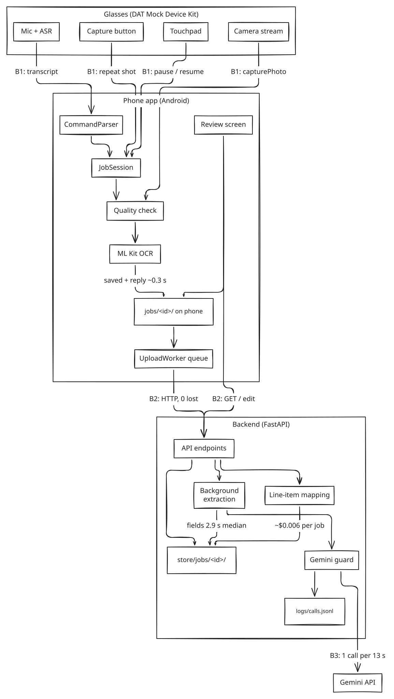
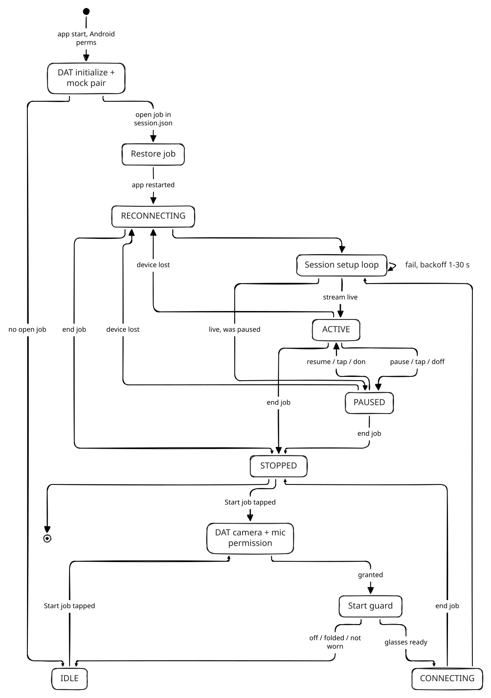
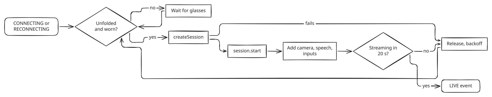
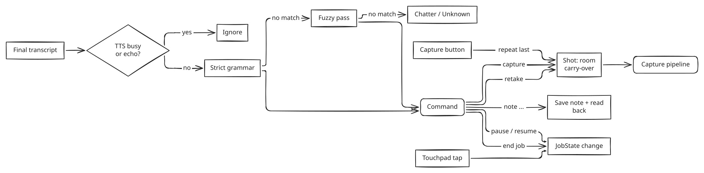
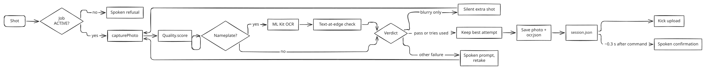
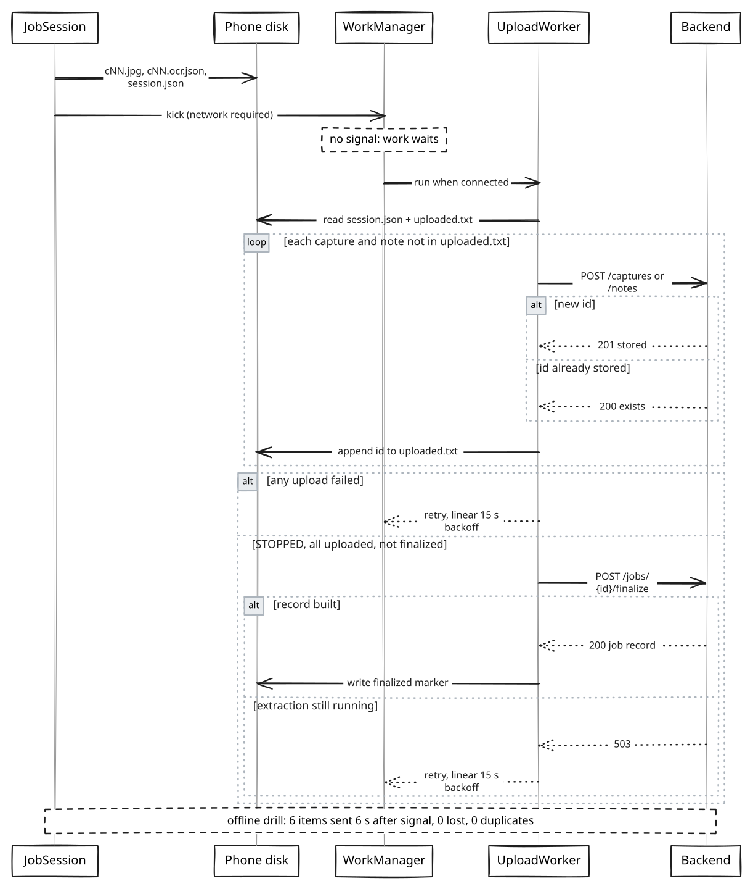
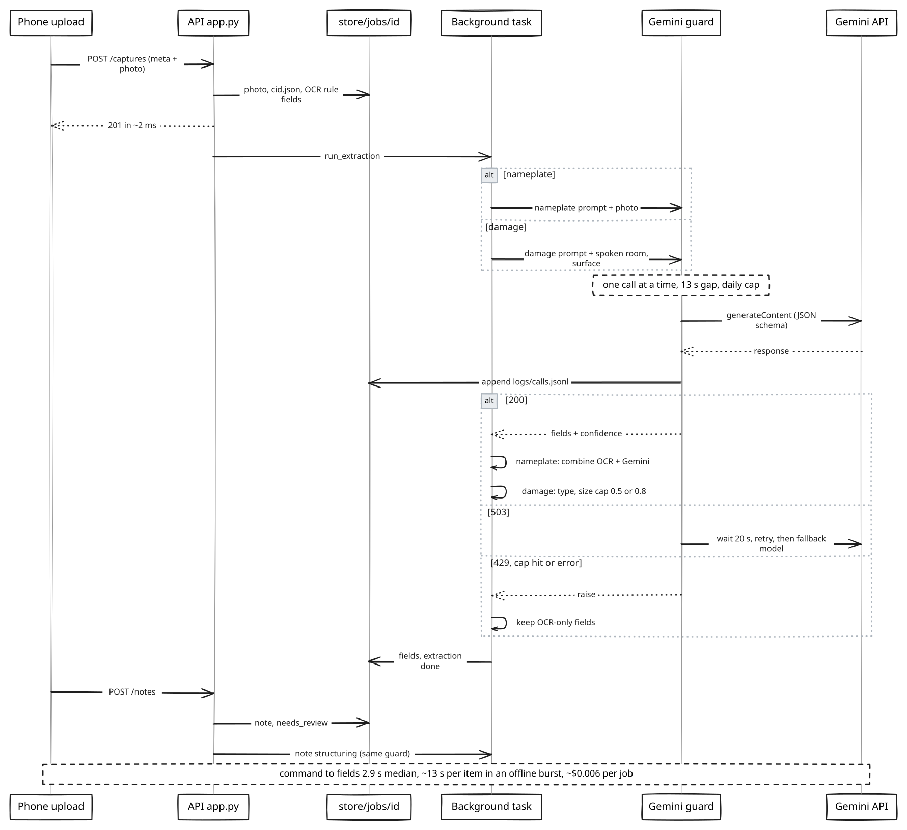
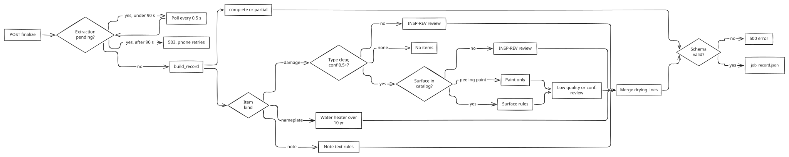
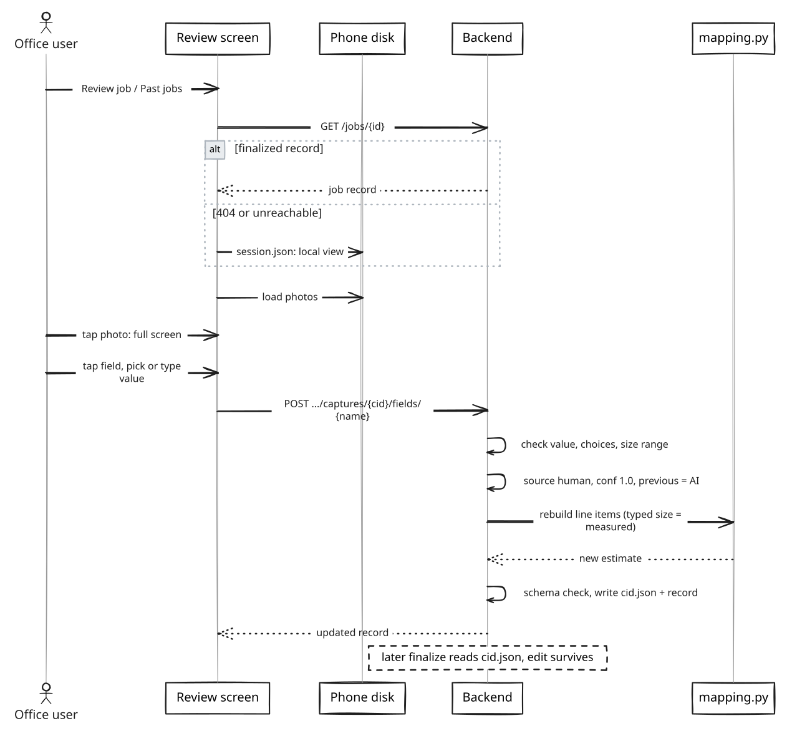
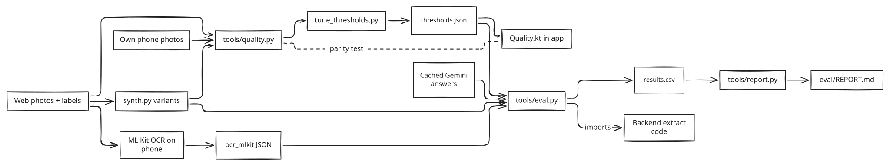

# FieldCapture system design

These diagrams were drawn from the code (`android/app/src/main/java/com/fieldcapture/`, `backend/`, `tools/`). Where the code and the README disagree, the diagrams follow the code; the differences are listed at the end. Each diagram has a Mermaid source (`.mmd`), an editable Excalidraw scene (`.excalidraw`, open it at excalidraw.com) and an SVG, all in [diagrams/](diagrams/). They were made with `@excalidraw/cli` 1.2.0, locally, with nothing uploaded.

Measured numbers on the diagrams come from the README (Extraction and confidence, Job record / offline) and `eval/REPORT.md` (Stretch D):

| step | measured | where |
|---|---|---|
| voice command to photo passed quality check | 314-324 ms median (walks 1-3) | REPORT, Stretch D |
| command to spoken confirmation (after the local save) | about 0.3 s | REPORT, Stretch D |
| voice command to capture has its AI fields | 2.9 s median, 3.3 s p90 (walk 3) | README, REPORT |
| offline burst after sync | ~13 s per item (free-tier spacing); 8 items gave a complete record 101 s after the network returned | README, REPORT |
| offline drill | 6 items uploaded 6 s after the network returned, 0 lost, 0 duplicates | README |
| cost per job | ~$0.006 typical walk (2 nameplates, 5 damage, 3 notes); measured $0.0048 baseline, $0.0024 `lean` | README, REPORT |

---

## 0. Overview

Editable: [overview.excalidraw](diagrams/overview.excalidraw)

The glasses supply four inputs: the camera stream (`capturePhoto`), speech transcripts from DAT Speech, the capture button and the touchpad. On the phone, `CommandParser` turns a transcript into a command, `JobSession` runs the job, and every photo goes through the quality check (plus ML Kit OCR for nameplates) before it is written to `jobs/<id>/`. Only after that does the `UploadWorker` queue send anything to the FastAPI backend. The backend stores each item, extracts fields in the background through a single Gemini guard, and maps fields to line items in `job_record.json`. Three trust boundaries are labelled: **B1** glasses↔phone (DAT link; on the mock it runs in the same process), **B2** phone↔network (plain HTTP over `adb reverse`, or an ngrok URL in testing; the backend has no auth), **B3** backend↔Gemini (API key in `backend/.env`; photos leave for Google, and free-tier requests may be used by Google). The design is local-first: the phone never waits on the network or the model to confirm a capture. A technician in a basement with no signal can keep working, and nothing they captured depends on a connection.

**Where data lives**

| place | contents |
|---|---|
| phone, `getExternalFilesDir()/jobs/<id>/` | `session.json` (job state, events, captures, notes; written via tmp + rename), `cNN.jpg`, `cNN.ocr.json`, `uploaded.txt` (ids already accepted), `finalized` marker |
| backend, `backend/store/jobs/<id>/captures/` | `cNN.jpg`, `cNN.json` (fields, quality, timing, extraction state), `cNN.ocr.json`, `cNN.vlm.json` (raw Gemini answer) |
| backend, `backend/store/jobs/<id>/notes/` | `nN.json`, `nN.vlm.json` |
| backend, `backend/store/jobs/<id>/job_record.json` | the schema-validated record returned by finalize and edited by review |
| backend, `backend/logs/calls.jsonl` | one line per Gemini call (model, status, latency, tokens); also the source of truth for the 13 s gap and the daily cap |

## 1. Session states

Editable: [session-states.excalidraw](diagrams/session-states.excalidraw)

Editable: [session-setup.excalidraw](diagrams/session-setup.excalidraw)

On launch the app asks for the Android permissions, then `boot()` calls `Wearables.initialize`, pairs the mock glasses (debug build), starts watching the active device and a 1 s frame watchdog, and restores any job whose `session.json` is not IDLE/STOPPED (it goes straight to RECONNECTING). **Start job** checks the DAT camera and microphone permissions, then the start guard refuses with a spoken reason if the glasses are off, folded or not worn. Once a job is open, the session setup loop waits until the glasses are unfolded and worn, creates a fresh `DeviceSession` (a dead one is never reused), adds camera, speech and inputs, and emits LIVE when the stream is STREAMING. If setup fails it backs off 1/2/4/8/15/30 s and never gives up while the job is open. The device going away, a fold, a closed stream or 5 s without frames moves the job to RECONNECTING. The tech's PAUSED state is remembered (`pausedBeforeDrop`), so a reconnect lands back in PAUSED. The reason for this design is that the `JobRecord` outlives any number of SDK sessions: the mock showed that powerOff leaves a "STARTED" session with no frames, so the app owns its own state machine instead of trusting the SDK's.

## 2. Capture pipeline

Editable: [capture-commands.excalidraw](diagrams/capture-commands.excalidraw)

Editable: [capture-pipeline.excalidraw](diagrams/capture-pipeline.excalidraw)

Only final transcripts count. A transcript heard while TTS is speaking (plus 0.5 s), or one contained in our own reply from the last 6 s, is dropped as echo. `CommandParser` first tries the strict grammar, then a fuzzy pass: edit distance 1-3 on command, room and surface words, leading fillers dropped, and sound-alikes like "captain" read as "capture". Note text is never altered. A capture becomes a `Shot` (kind, room, surface, unrecognised words). The room carries over from the last capture only when nothing unrecognised was said. "retake" re-shoots the last shot as a new capture with `retake_of`, and the capture button repeats the last shot. The touchpad tap pauses or resumes through the SDK. Inside the capture lock, each attempt is `capturePhoto`, EXIF upright, then `Quality.score` on a 360 px luma image (Laplacian blur, across/down motion ratio, brightness and dark fraction, centre glare, edge density). Nameplates also go through ML Kit OCR and the text-at-edge cut-off check (a line of 3+ characters within 3% of the frame edge). A blurry-only verdict gets up to 2 silent extra shots. Any remaining failure is spoken ("Too dark. Turn on your light.") and gets up to 2 retakes, 4 s apart. The best attempt is kept and flagged `low` if it never passed, so the walk is never blocked. The photo, `cNN.ocr.json` and `session.json` are written **before** the spoken confirmation, about 0.3 s after the command, so a reply always means the capture is on disk.

## 3. Upload and offline

Editable: [upload-offline.excalidraw](diagrams/upload-offline.excalidraw)

Each capture or note kicks one unique WorkManager job named `upload`, which requires a CONNECTED network and uses a linear 15 s backoff. With no signal, the work simply waits. The worker walks every job folder and posts each capture (multipart: meta JSON, plus the photo and the OCR result) or note whose id is not in `uploaded.txt`. It appends the id only after a 200/201. The backend stores each id once and answers `200 exists` to a repeat, so a crash between the POST and the marker cannot duplicate anything. When a job is STOPPED, every item is accepted and there is no `finalized` marker, the worker calls finalize with a 120 s read timeout. A 503 (extraction still running) or any failure returns `Result.retry()`. Files plus marker lines replaced a database: state is atomic per file, restart-safe, and the airplane-mode drill lost and duplicated nothing.

## 4. Backend extraction

Editable: [backend-extraction.excalidraw](diagrams/backend-extraction.excalidraw)

`POST /captures` writes the photo and `cNN.json` with the voice fields (room/surface 0.9, unrecognised words 0.3) and, for nameplates, the ML Kit rule-parser fields. It answers 201 in about 2 ms and queues the model work as a FastAPI background task. For nameplates, Gemini reads the same photo and `nameplate.combine` merges the two readers. If they agree, confidence is 1-(1-a)(1-b). If only one reader has a value, it is multiplied by 0.7 (the appliance type keeps Gemini's confidence). If they disagree, the higher one is multiplied by 0.4. An OCR "biggest text" fallback make only counts when it agrees. There are two readers because Gemini's own confidence stays around 0.8 even when it is wrong, so agreement between independent readers is the signal that brings wrong answers down. Damage photos get the spoken room and surface in the prompt, and Gemini returns one of 8 damage types plus a size whose confidence is capped at 0.5 without a reference object and 0.8 with one. Notes are structured into location / issue / material / severity / action, discounted ×0.8 for ASR errors and always flagged `needs_review`. Every call goes through `gemini.generate` under one lock: 13 s since the last logged call, a daily cap (450 for 3.1 Flash-Lite, 18 for any other model), two tries per model with a 20 s wait on 503 before falling back to 2.5 Flash, and a stop on 429. Any exception leaves the capture with its OCR-only fields (none for damage or notes). One call at a time keeps a free-tier key inside its RPM and daily quota, and calls.jsonl makes every cent and second auditable. The cost is ~13 s per item when an offline burst syncs.

## 5. Finalize and estimate

Editable: [finalize-estimate.excalidraw](diagrams/finalize-estimate.excalidraw)

Finalize polls the job's capture and note files every 0.5 s for up to 90 s while any is still `extraction: pending`, then answers 503 so the phone retries later. `build_record` keeps the ids the phone listed, marks the job `partial` with `missing` ids if any were never stored, and runs `mapping.line_items`. For damage, an unclear type (null or confidence < 0.5) becomes `INSP-REV` needs_review, `none` gives no items, and a surface with no catalog item becomes `INSP-REV` "price by hand". Peeling paint on a wall or ceiling is priced as paint only (`PNT-WALL` / `PNT-CLG`). Other surfaces follow per-surface rules (ceiling, insulation, floor, cabinet, wall by damage type and area). Any item from a `low` photo, or with confidence < 0.5, is `needs_review`. A water heater older than 10 years becomes `WH-RPL` `suggested`, note text rules add needs_review items, and all `DRY-EQ` drying lines are merged into one (max days, union of sources). The record is validated against `job_record.schema.json` (500 on failure) and written to `job_record.json`. Rules rather than the model produce prices, so every line item has a quantity basis and source ids a reviewer can check.

## 6. Review and edit

Editable: [review-edit.excalidraw](diagrams/review-edit.excalidraw)

The review screen calls `GET /jobs/{id}`. If the job is not finalized or the backend is unreachable, it builds a local view from `session.json` (photos, quality, spoken room/surface) and says the AI results come after upload. Photos always load from the phone, so the full-screen viewer (pinch-zoom, quality result, fields, the photo's line items) works offline. Tapping a field sends `POST /jobs/{id}/captures/{cid}/fields/{name}`, which needs a finalized record. The backend validates the value (damage type from its list, size 0-5000 cm), stores it as source `human` with confidence 1.0 and keeps the AI original under `previous` (repeated edits keep the first AI value). It then re-reads every capture, rebuilds all line items (a typed size counts as `measured`), validates the schema and writes both `cNN.json` and `job_record.json`. Because the edit lives in the capture file that `build_record` reads, a later finalize keeps it. The estimate is rebuilt rather than patched because one field (surface, type, size) can change several line items and the merged drying line, and only a full rebuild keeps them consistent.

## 7. Offline evaluation

Editable: [offline-eval.excalidraw](diagrams/offline-eval.excalidraw)

The development set is openly licensed web photos with labels (`data/web/labels.csv`), synthetic dark/blurry/glare/cut-off copies from `tools/synth.py`, and a few of the user's own phone photos. `tools/quality.py` is the Python twin of `Quality.kt` (a unit test checks the two agree to 4 decimals). `tools/tune_thresholds.py` picks each threshold on the tune split with at most 10% false rejects, takes the middle of the class gap, and `--write` ships `android/app/src/main/assets/thresholds.json` (still `provisional`). ML Kit OCR was run on the phone through the `ocr:<dir>` debug hook and its JSON committed, so `tools/eval.py` reruns without a phone. It also imports the backend's `extract` and `nameplate` code and reads Gemini answers from `eval/cache/`, so it reruns without API calls. `tools/report.py` turns `eval/results.csv` into `eval/REPORT.md`. Keeping one code path for app, backend and eval means the reported accuracy is the accuracy of the shipped code.

---

## Failure paths

| failure | what happens | diagram |
|---|---|---|
| no signal | captures and notes saved locally with a spoken reply; WorkManager waits for CONNECTED, then sends; retries with linear 15 s backoff | 2, 3 |
| app killed or crash mid-job | `session.json` restored at launch, job goes to RECONNECTING with the same id; a crash between POST and `uploaded.txt` re-sends and gets `200 exists` | 1, 3 |
| glasses disconnected mid-job | active device null, fold, stream closed / critical error, or 5 s without frames moves the job to RECONNECTING, which says "Glasses disconnected."; new session with backoff; captures refused with "Glasses not connected." until back | 1 |
| glasses taken off | session paused ("Glasses off. Paused."), resumed on don; reconnect waits for don | 1 |
| bad photo | silent extra shots / spoken prompt and retakes; best attempt kept as `low`, which later forces `needs_review` | 2, 5 |
| Gemini 503 | 20 s wait, retry, then fallback model | 4 |
| Gemini 429, local daily cap, timeout or any error | exception caught: nameplate keeps ML Kit fields; damage and notes get no AI fields (damage then maps to `INSP-REV`) | 4, 5 |
| finalize before extraction finishes | waits up to 90 s, then 503; phone retries | 3, 5 |
| record fails the schema | finalize or edit returns 500, nothing is written | 5, 6 |

## Known limitations (from the README)

- The reported numbers are a development set (web + synthetic photos); the own-capture test set is not shot yet.
- Cut-off is checked only for nameplates, from OCR text touching the edge.
- Damage-type confidence is not calibrated (0.90 wrong vs 0.95 right); damage line items need review.
- Not run on real glasses. On the mock, speech stops reaching the app after a glasses reconnect until the app restarts; mock stills are 640×480; ASR final confidence is always 0.0.
- Size from one photo is a model estimate; notes garble in noise.
- The backend has no auth; Gemini calls are serialized 13 s apart, so an offline burst takes ~13 s per item to extract after sync.

## Differences found between code, README and the brief

Not fixed, only listed.

1. **The latency and cost figures in the brief for these diagrams are not in the README.** "0.3-0.9 s command to photo", "median 7.7-12.9 s photo to AI result", "about 1 s end job to record" and "$0.01 per job of 13-17 photos" don't appear in the README (whose Results section has only accuracy numbers) or in `eval/REPORT.md`. The diagrams use the measured values in the table at the top instead. No end-job-to-record time is measured anywhere.
2. **"start job" by voice.** The README lists "start job" as a voice command, but speech runs only inside a DAT session, which is created by `startJob()` and released on STOPPED. From IDLE or STOPPED the words never reach the app, and during an open job the reply is "Job already running." A job starts from the **Start job** button (or the debug adb broadcast).
3. **Blurry photos get more than silent shots.** The README says a blurry-only failure triggers up to 2 silent extra shots, "otherwise" a spoken prompt and 2 retakes. In `JobSession.capture()`, a photo that is still blurry after the silent burst also gets "Blurry. Hold still." and the retake rounds, and each round can burst again: up to 3 rounds × 3 shots = 9 photos.
4. **"Nothing in view" and glare are nameplate-only.** `thresholds.json` sets `empty_edge_density` and `glare_frac` only for nameplates, so a damage photo is never flagged as empty or glare. The README architecture box lists "blur / dark / glare / empty" without saying so.
5. **Partial records.** The README says a job finalized before all captures arrive is `partial` and "becomes `complete` when they land". The phone calls finalize only after every capture and note has returned 200/201, then writes a `finalized` marker and never finalizes again. Nothing on the backend rebuilds the record when a late item lands. So `partial` happens only with a direct API call, and turning it `complete` needs a second finalize call.
6. **Retakes are extra captures.** README: "retake re-shoots the last capture". The code saves a new `cNN` with `retake_of`; the original stays in the record, and `mapping.line_items` doesn't skip retaken captures, so both produce line items (only `DRY-EQ` is merged).
7. **Gemini 503 handling.** `docs/MODEL_NOTES.md` says "503 moves to the next model". `gemini.py` tries each model twice, waiting 20 s after each 503, before moving on.
8. **Edits need a finalized record.** The README says field edits need the backend to be reachable. The endpoint also returns 404 until `job_record.json` exists, so an uploaded but not yet finalized job can't be edited.
9. **Transport.** The README architecture says "HTTPS / adb reverse". The default `BACKEND_URL` is `http://127.0.0.1:8000`; HTTPS only applies when `fc.backend` points at an ngrok URL (the worker sends the `ngrok-skip-browser-warning` header for that case). README Assumptions already says production would use HTTPS.
10. **Rendering note, not a code difference.** For the three sequence diagrams, `@excalidraw/cli` 1.2.0 emits some `alt`/`loop` frame lines with negative width, which its own SVG export rejects. Those lines were normalised in the `.excalidraw` scene (same position, positive size) and the SVG was rendered from that scene with `excalidraw render`. Flowcharts and the state diagram were exported with `mermaid --elbow` as specified.
